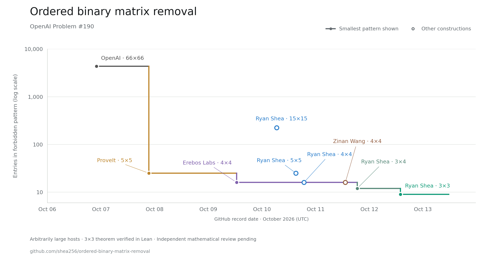

# Ordered binary matrix removal

**Candidate 3×3 obstruction · Main theorem checked in Lean · October 12, 2026**



We give a construction for the fixed ordered binary pattern

```text
0 1 1
1 0 1
1 1 0
```

The **3×3 pattern has nine entries**, down from twelve in our previous 3×4
construction and sixteen in the earlier external 4×4 results. Arbitrarily
large matrices can contain extremely few copies of this pattern while still
requiring many edits to eliminate it: **no polynomial removal bound holds**.
Copies preserve separate row and column orders and match both zeros and ones.
Repairs may change any entry in either direction.

Read the [paper](manuscript.pdf), [Markdown manuscript](manuscript.md), and
[Lean theorem](formal/OrderedRemoval/Crown/Complete.lean).
For every c,C,ε₀>0, the theorem gives a fixed 0<ε<ε₀ such that, for every
size threshold N, some square host of order n≥max(1,N) requires at least
εn² edits to become pattern-free and has fewer than c ε^C n⁶ copies.

## What is verified

**The full qualitative theorem for the 3×3 pattern is checked in Lean.**
The source-bound audit covers 92 project modules, 573 named theorems and
2,163 declarations, including inherited infrastructure. A separate AI reviewer
found no gap in the written proof. Independent mathematical peer review remains
pending; we make no global minimality or first-ever claim.

The written and formal proofs use two versions of the host, with m=2^h:

| Version | Anchor size per mode and axis | Host order n | Copies | Repair lower bound |
| --- | --- | --- | --- | --- |
| Written proof and separate-agent review | m | (8h+2)m | exactly 7m⁴ | m² |
| Lean certificate | 2m | (14h+2)m | at most 2mn⁴ | m² |

Both establish the same no-polynomial-bound theorem. **The exact 7m⁴ count
and the smaller host's quantitative parameters are outside the Lean certificate.**
See [formal scope](formal/README.md), the
[audit](verification/reference/crown-formal-audit.json),
[separate written-proof review](verification/reviews/three-by-three-adversarial.md),
and [model alignment check](verification/reviews/three-by-three-formal-scope.md).
The [original proof snapshot](proofs/three-by-three.md) is preserved unchanged
for its review hashes; the manuscript gives the current verification status.

## Baseline and attribution

The tree, threshold entries, protected sampling and propagation originate in
OpenAI's 66×66 construction and formalization. ProveIt supplied earlier 5×5
work; Erebos Labs published a 4×4 theorem and Lean proof before our 4×4 PR.
Zinan Wang's 4×4 manuscript also gives the exact copy count found in our
earlier quantitative refinement, with a different mode order.

Our 3×3 construction uses one anchor on each axis, suffix column anchors,
vertical-dummy ones, and a new all-copy classification. See
[BASELINE.md](BASELINE.md) and [ATTRIBUTION.md](ATTRIBUTION.md) for pinned
sources, verification stages and the bounded novelty search. The preceding
[3×4 certificate](results/previous-three-by-four.json) and
[4×4 refinement](proofs/optimized-order.md) remain available.

The chart uses dated **GitHub records**, with proportional UTC spacing.
Erebos Labs' [v1.0.0 release](https://github.com/erebos-labs/ordered-matrix-removal-4x4/releases/tag/v1.0.0)
was published October 9, 2026 at 12:40:51 UTC. The line follows the smallest
entry count among the selected records, not a complete priority history.
See [timestamp sources and scope](assets/README.md).

## Reproduce

```sh
python3 scripts/run_checks.py
# With the pinned Lean/Lake toolchain installed:
python3 scripts/run_crown_formal_checks.py
python3 verification/check_crown_formal_model.py --output .context/crown-model-check.json
```

The default exact checks use Python 3.9+ and the standard library. They include
two seven-depth censuses, a separately written reviewer checker, repair guards,
Boolean propagation, and adverse variants. Optional SAT discovery and repair
searches are documented separately. Finite checks support the proof; the Lean
certificate establishes the universal theorem. See
[verification scope](verification/README.md), [RESULT.md](RESULT.md),
[RUNLOG.md](RUNLOG.md), and [HANDOFF.md](HANDOFF.md).

Build the paper with `python3 scripts/build_manuscript.py`; add
`--regenerate-tex` with Pandoc 3.6.4 installed to regenerate LaTeX first.
The [Markdown manuscript](manuscript.md) is the mathematical source;
the [template](tex/template.tex) and [preamble](tex/preamble.tex) control the
title, abstract, typography, and pagination. The pdfLaTeX build requires
the packages listed in the preamble, including `microtype`, `parskip`,
`needspace`, `xurl`, and `bookmark`. After editing the Markdown or template,
regenerate LaTeX; `python3 scripts/build_manuscript.py --check-tex` checks
that the generated source is current. PDF links open repository files online.
The [bibliography](references.bib) supplies the manuscript's `[@key]` citations.
Pandoc's built-in citeproc generates linked numeric citations and references
using [the citation style](tex/references.csl); unresolved citations fail the
build. Regenerate LaTeX after changing either bibliography file as well.
The [improvement record](IMPROVEMENTS.md) records development, not priority.
Prepared by Ryan Shea with Codex assistance. Licensed under
[Apache 2.0](LICENSE); see [NOTICE](NOTICE).
